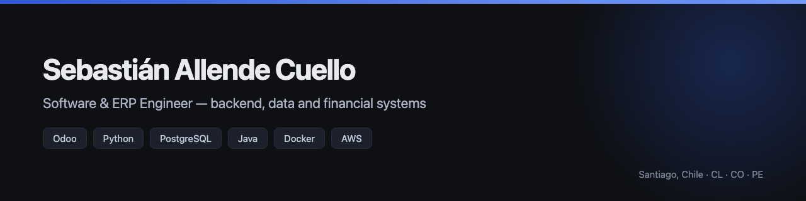

  
  
  

I build and run the systems a business actually depends on — ERP, inventory, accounting and electronic
invoicing across four companies in three countries. My work sits where correctness of financial data and
continuity of service are not features but the whole job.

---

### What I've been doing

**Migrated an ERP platform five major versions forward** (Odoo 14 → 19) across four legal entities in
Chile, Colombia and Peru — end to end, with no data loss and no rollback. Consolidated 41 custom modules
into 18, rewrote them against a changed API, and re-certified electronic invoicing for three tax
authorities.

**Built the monitoring that keeps it honest** — around 46 detectors running every six hours that
reconcile the inventory ledger against the general ledger, track documents rejected by each regulator,
and project when authorised invoice numbering ranges will run out. It surfaced a systematic
double-counting of inventory cost that had been accumulating unnoticed for over a year.

**Built a feature-flag service in Rust from scratch** — [FlagForge](https://github.com/Ssebv/flagforge).
A pure evaluation engine with no I/O, which is what lets the same crate compile to WebAssembly: the dashboard's rule preview calls the identical function production does,
rather than approximating it. Grew A/B experiments on the same foundation — deterministic bucketing doubles as
assignment, so counters stay bounded by time rather than traffic. 245 tests, including one that runs a real
server on a real socket and compares 300 users evaluated locally against the server's answers.

---

### Writing

| | |
|---|---|
| [**The bugs that survive an ERP upgrade are the quiet ones**](https://ssebv.github.io/writing/erp-migration.html) | The failures that raised errors were fixed in days. The ones that changed behaviour without raising anything lasted weeks — including a single field whose default value silently emptied filters across the system. · *6 min* |
| [**Alert quality beats alert count**](https://ssebv.github.io/writing/health-check.html) | Why an alert nobody acts on is a defect rather than a nuisance — including the detector of mine that was confidently wrong, and what it would have cost to act on it. · *5 min* |

---

### Selected projects

| Project | | |
|---|---|---|
| [**FlagForge**](https://github.com/Ssebv/flagforge) | Multi-tenant feature flags: targeted rollouts, reusable segments, A/B experiments, deterministic bucketing, an audit trail — and a dashboard that runs the real evaluation engine | `Rust` |
| [**odoo-19-migration-field-notes**](https://github.com/Ssebv/odoo-19-migration-field-notes) | Field notes from a production Odoo 14 → 19 upgrade — the failures that raise no error | `Open source` |
| [**systematic-trading-showcase**](https://github.com/Ssebv/systematic-trading-showcase) | Systematic trading research platform — architecture, risk design and engineering writeup | |
| [**TBSim Genetic Algorithm**](https://github.com/Ssebv/TBSimAlgoritmoGenetico_HPC_LOCAL) | Parallel genetic algorithm (Jenetics) with a computational scalability study — undergraduate thesis | `Java` |
| [**AI News Analyzer**](https://github.com/Ssebv/AI-Analizer-Llama) | News analysis system built with LangChain and LangGraph behind a Streamlit interface | `Python` |
| [**E-commerce REST API**](https://github.com/Ssebv/ecommerce-fastapi-rest) | REST API for an e-commerce backend | `FastAPI` |
| [**Introduction to Linux**](https://github.com/Ssebv/introduccion-linux) | 16-chapter course, with an unusually deep treatment of the permission model | `Guide` |

[→ All repositories](https://github.com/Ssebv?tab=repositories)

---

### Stack

| | |
|---|---|
| **Backend** | Python · Odoo 14–19 · FastAPI · REST APIs · Rust (axum, sqlx, Leptos / WASM) · Java · JavaScript / TypeScript |
| **Data** | PostgreSQL · SQL / PL-SQL · migrations · ETL · SAP S/4HANA |
| **Infrastructure** | Linux · Docker · Git · Odoo.sh · AWS · Azure · HPC |
| **Compliance** | SII (Chile) · DIAN (Colombia) · SUNAT (Peru) · Active Directory · IAM |
| **AI** | LLM APIs · LangChain · prompt engineering · NLP |

---

### Currently

**IT Manager & ERP Administrator** at Toyng — running the ERP for four companies across Chile, Colombia,
Peru and China, and supporting their accounting, warehouse and sales teams.

Open to new opportunities · [sallendec@outlook.com](mailto:sallendec@outlook.com) · [ssebv.github.io](https://ssebv.github.io)
